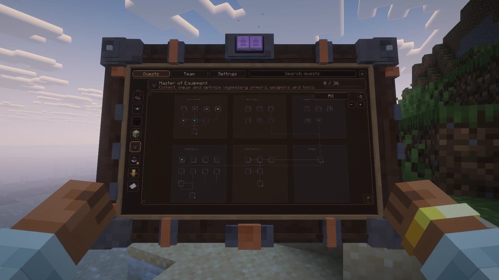
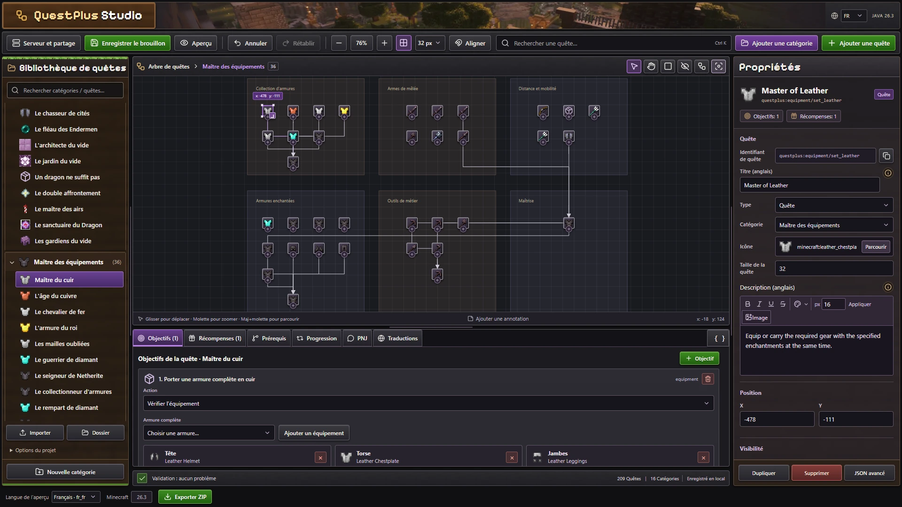

# QuestPlus

**Votre aventure au creux des mains.** Une tablette 3D animée pour découvrir vos quêtes, suivre vos objectifs et récupérer vos récompenses sans quitter votre monde.

**Minecraft Java 26.3 · Fabric · Java 25 · Version 0.2.0**

## Jouer

- **209 défis Vanilla+** pour explorer, construire, combattre et collectionner de l'équipement.
- Arbres de quêtes interactifs, objectifs épinglés au HUD et récompenses en objets ou en expérience.
- Progression personnelle ou partagée en équipe ; quêtes simples, répétables et à paliers.
- Interface en français, anglais, espagnol et chinois simplifié.

Installez **QuestPlus + Fabric API** dans `mods/`, côté client et serveur pour l'expérience complète. Pour les bras et la tablette animés, ajoutez **Player Animation Library 1.2.8** et **First Person PAL Expansion 1.1.1** côté client. Ouvrez les quêtes avec **J** ; la touche est configurable. Une interface 2D est disponible sans ces animations.

## Créer un modpack

**Quest Studio** permet de dessiner les arbres, modifier les objectifs, ajouter des traductions et exporter un ZIP, sans écrire les JSON à la main. Il fonctionne aussi hors connexion après chargement. L'édition connectée est facultative et demande l'accord d'un opérateur dans Minecraft.

Les définitions restent des JSON lisibles. IDs et tags moddés, prérequis, conditions, annotations et API Java permettent d'adapter les quêtes à votre pack.

## Documentation

**[English documentation website](https://alexistb2904.github.io/QuestPlus/docs/)** offers Markdown guides for setup, Quest Studio, authoring, objectives, rewards, commands and compatibility. Its source is in [`docs-site/`](docs-site/).

| Besoin | Guide |
| --- | --- |
| Installer, jouer, créer et importer un pack | [Démarrage](docs/getting-started.md) |
| Versions, dépendances, shaders et animations | [Compatibilité](docs/compatibility.md) |
| Format des quêtes et exemples | [Référence JSON](docs/json-schema.md) · [JSON Schema](docs/quest.schema.json) |
| Équipes et récompenses | [Progression en équipe](docs/team-progression.md) |
| Quest Studio et édition connectée | [Éditeur](web/editor/README.md) · [Service web](web/api/README.md) |
| Compiler et tester | [Développement](docs/development.md) |

## FAQ

**Les shaders sont obligatoires ?**  
Non. Les captures sont réalisées avec **Iris + Complementary Reimagined**. Les versions utilisées et les limites des tests sont indiquées dans le [guide de compatibilité](docs/compatibility.md).

**Faut-il un compte ou un service en ligne ?**  
Non pour jouer et créer des packs locaux. Le partage et l'édition directe d'un serveur utilisent le service web facultatif.

**Puis-je utiliser les objets de mes autres mods ?**  
Oui, avec leurs IDs et tags pour les types d'objectifs pris en charge. Une mécanique personnalisée peut demander une intégration via l'API Java.

[Signaler un problème](https://github.com/alexistb2904/QuestPlus/issues) · [Description Modrinth](docs/modrinth.md) · [Médias du showcase](docs/showcase/README.md)
