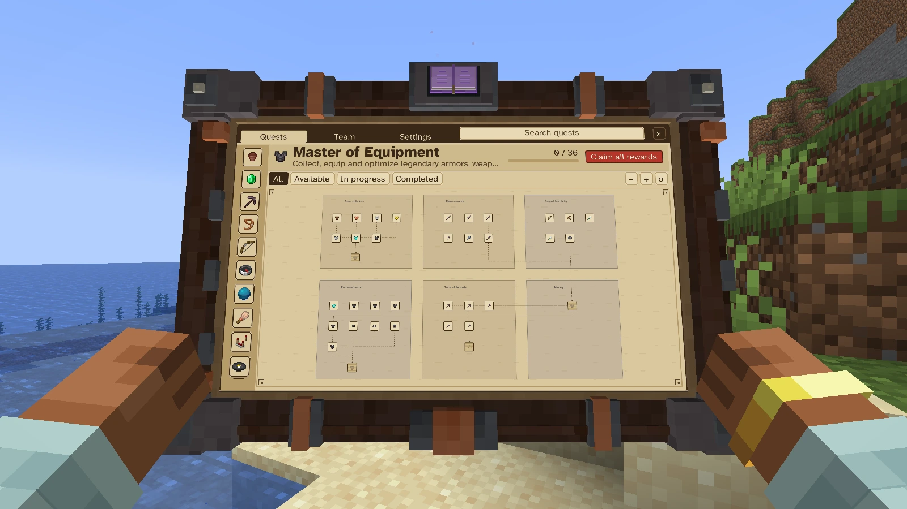
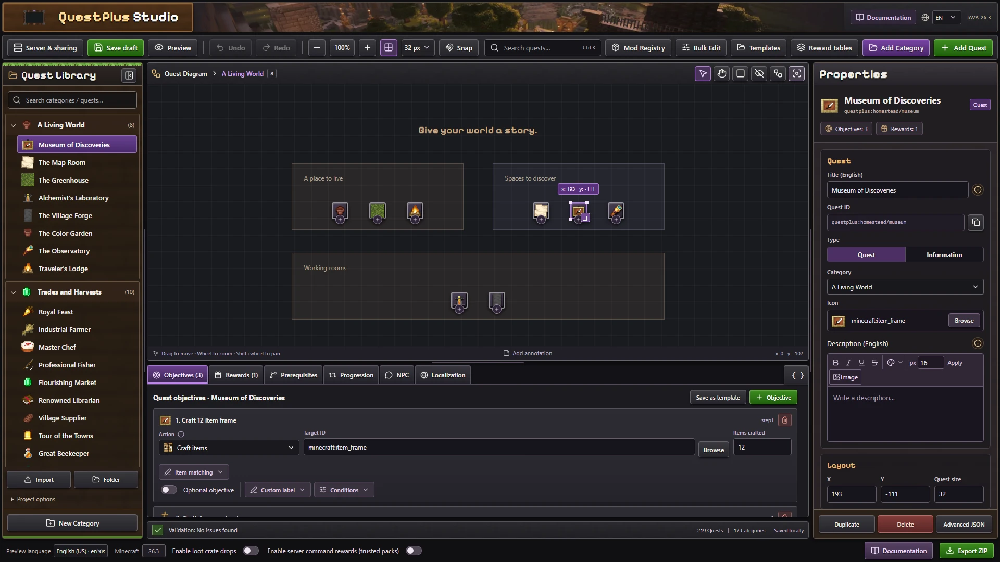

# QuestPlus

Your adventure, in your hands. Explore quest trees, track objectives and claim rewards from an animated Minecraft tablet.

**Minecraft Java 26.3 · Fabric · Java 25**

## Play

Install **QuestPlus and Fabric API** in `mods/` on the client and server. The current JAR configuration bundles Player Animation Library and First Person PAL Expansion for the tablet animations.

Press **J** to open your quests. Explore the bundled survival challenges, pin up to three objectives, claim rewards and share progress in a team. A flat interface, reduced motion, brightness and scale settings are available. Shaders are optional.

[Installation](https://alexistb2904.github.io/QuestPlus/docs/guide/install.html) · [Tablet guide](https://alexistb2904.github.io/QuestPlus/docs/guide/tablet.html) · [Compatibility](https://alexistb2904.github.io/QuestPlus/docs/guide/compatibility.html)

## Create a quest pack

[Open Quest Studio](https://alexistb2904.github.io/QuestPlus/) to arrange quests, configure objectives and rewards, add translations and export a ZIP. The editor supports local authoring without an API. Connected editing uses the optional web service and an operator's approval inside Minecraft.

Readable JSON5 definitions, modded IDs and tags, reward tables and the Java API let you adapt progression to your pack. Supported FTB Quests definitions can be converted with a review report.

[First quest walkthrough](https://alexistb2904.github.io/QuestPlus/docs/guide/first-quest.html) · [Modpack guide](https://alexistb2904.github.io/QuestPlus/docs/guide/modpack-creators.html) · [Java API](https://alexistb2904.github.io/QuestPlus/docs/reference/java-api.html)

## Find the right guide

| Goal | Documentation |
| --- | --- |
| Play with friends | [Teams](web/docs-site/content/guide/teams.md) |
| Install or update a pack | [Import and publish](web/docs-site/content/guide/import-and-publish.md) · [Backups](web/docs-site/content/guide/backups-and-updates.md) |
| Solve a problem | [Troubleshooting](web/docs-site/content/guide/troubleshooting.md) |
| Build or contribute | [Development](web/docs-site/content/reference/development.md) |
| Host connected editing | [Web setup](web/api/README.md) |
| Browse all guides | [English documentation](https://alexistb2904.github.io/QuestPlus/docs/) |

## Repository

`web/` owns authoring and the optional API. `mod/client/` owns Minecraft presentation. `mod/server/` owns validation, progression and rewards. The Gradle wrapper and editable mod assets are in `mod/`; run `cd mod && ./gradlew build` to build. Client and server compile into **one Fabric JAR**. Player saves remain on the Minecraft server. On Windows, run `dev.bat` for development commands. See [CONTRIBUTING.md](CONTRIBUTING.md) for a fresh checkout, prerequisites and checks.

The documentation includes new Minecraft and Studio captures, expandable GIF demonstrations and a [capture manifest](web/docs-site/content/public/media/manifest.json). Technical investigation notes remain in `docs/`.

[Report an issue](https://github.com/alexistb2904/QuestPlus/issues) · [Documentation source](web/docs-site/) · [Release description](docs/modrinth.md)
