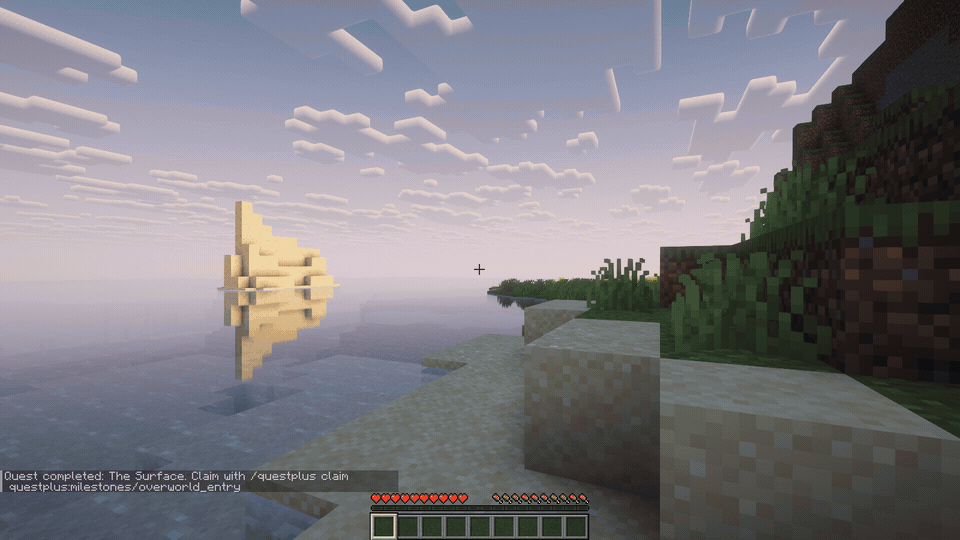
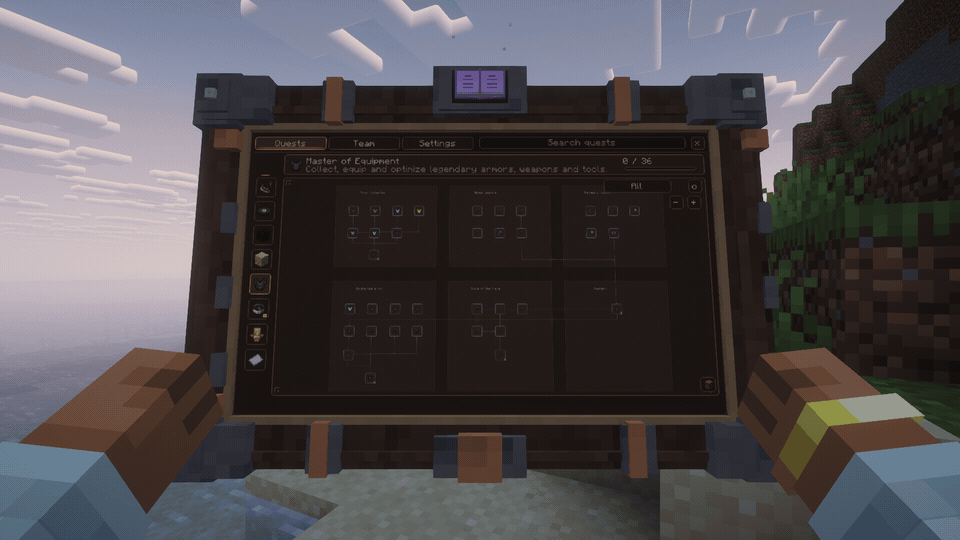
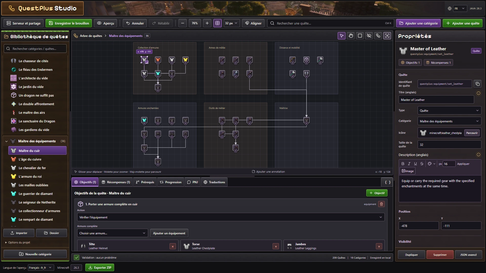

# Votre aventure, au creux des mains.

Sortez votre tablette, choisissez votre prochaine aventure et repartez explorer. **QuestPlus** donne une place aux quêtes dans votre monde : de vrais bras animés, un arbre interactif sur l'écran et vos objectifs à portée de main.

**Minecraft Java 26.3 · Fabric · Solo et serveur**

## Pour votre prochaine partie

- **209 défis Vanilla+** : exploration, construction, combat, récolte et équipement.
- **Votre progression en un regard** : épinglez jusqu'à trois quêtes au HUD.
- **Des récompenses à réclamer** : objets et expérience, avec des objectifs simples, répétables ou à paliers.
- **Une aventure partagée** : équipes et progression commune, validées côté serveur.
- **À votre façon** : mode tablette ou interface 2D, luminosité, échelle, mouvement réduit et touche configurable.

## Donnez une direction à votre modpack

Avec **Quest Studio**, construisez vos arbres dans le navigateur : placez les quêtes, reliez les prérequis, choisissez les objectifs et les récompenses, ajoutez des annotations et traduisez vos textes.

Exportez un ZIP pour vos joueurs, ou modifiez un serveur avec l'autorisation d'un opérateur dans Minecraft. Les packs utilisent des **JSON lisibles**, des IDs et tags moddés, et une **API Java** pour les mécaniques personnalisées. Le mode local reste utilisable hors connexion après chargement.

## Installation et compatibilité

| Élément | À installer |
| --- | --- |
| Jeu | Minecraft **Java 26.3**, Java **25** |
| Loader | **Fabric 0.20.1+** |
| Mod | **QuestPlus + Fabric API 0.165.2+26.3** sur le client et le serveur pour l'expérience complète |
| Tablette et bras animés | **Player Animation Library 1.2.8 + First Person PAL Expansion 1.1.1**, côté client |
| Shaders | Facultatifs ; médias capturés avec **Sodium 0.9.2 + Iris 1.11.7 + Complementary Reimagined r5.9.3** |

Appuyez sur **J** en jeu. Sans les extensions d'animation, l'interface 2D reste disponible. Les interfaces sont traduites en **français, anglais, espagnol et chinois simplifié**.

Les builds Forge, NeoForge, Quilt et Bedrock ne sont pas proposés. Les packs de shaders et les mods d'animation ont leurs propres versions compatibles : consultez la [matrice de compatibilité](https://github.com/alexistb2904/QuestPlus/blob/main/docs/compatibility.md).

## Documentation

**Joueurs** — [Installer et jouer](https://github.com/alexistb2904/QuestPlus/blob/main/docs/getting-started.md#installer) · [Équipes](https://github.com/alexistb2904/QuestPlus/blob/main/docs/team-progression.md) · [Shaders et dépendances](https://github.com/alexistb2904/QuestPlus/blob/main/docs/compatibility.md)

**Créateurs de modpacks** — [Créer et importer un pack](https://github.com/alexistb2904/QuestPlus/blob/main/docs/getting-started.md#créer-son-pack-avec-quest-studio) · [Référence JSON](https://github.com/alexistb2904/QuestPlus/blob/main/docs/json-schema.md) · [Édition connectée](https://github.com/alexistb2904/QuestPlus/blob/main/web/api/README.md)

**Développeurs** — [API Java](https://github.com/alexistb2904/QuestPlus/blob/main/server/src/main/java/dev/questplus/fabric/api/QuestPlusApi.java) · [Compiler et tester](https://github.com/alexistb2904/QuestPlus/blob/main/docs/development.md) · [Signaler un problème](https://github.com/alexistb2904/QuestPlus/issues)

## FAQ

**Quelle différence avec FTB Quests ?**  
QuestPlus est indépendant et met l'accent sur la tablette 3D, l'éditeur web et les packs JSON. [FTB Quests](https://github.com/FTBTeam/FTB-Quests) possède son propre système et son écosystème. Aucun import de ses fichiers n'est fourni : choisissez selon les besoins de votre pack.

**Faut-il un compte ou une connexion permanente ?**  
Non pour jouer et travailler sur un pack local. Le service web est facultatif ; il sert au partage et à l'édition connectée.

**Compatible avec mes autres mods ?**  
Les IDs et tags moddés sont acceptés pour les objectifs pris en charge. Une mécanique propre à un autre mod peut demander une intégration Java. La [matrice](https://github.com/alexistb2904/QuestPlus/blob/main/docs/compatibility.md) distingue les combinaisons testées des autres configurations.

**Le client seul suffit sur un serveur ?**  
Le serveur doit avoir QuestPlus pour fournir les quêtes et valider la progression. Utilisez le même JAR côté client pour la tablette. Le moteur peut aussi fonctionner côté serveur avec les commandes et le chat.

**Peut-on changer les quêtes sans perdre les sauvegardes ?**  
Les définitions sont séparées des sauvegardes. Gardez les IDs stables et sauvegardez le monde avant une modification mécanique. Un pack invalide est rejeté ; l'édition connectée prévoit une restauration des définitions.

*Captures réelles de Minecraft avec [Complementary Reimagined](https://modrinth.com/shader/complementary-reimagined), par EminGTR. Shaders non inclus. Quest Studio est une capture du navigateur.*
