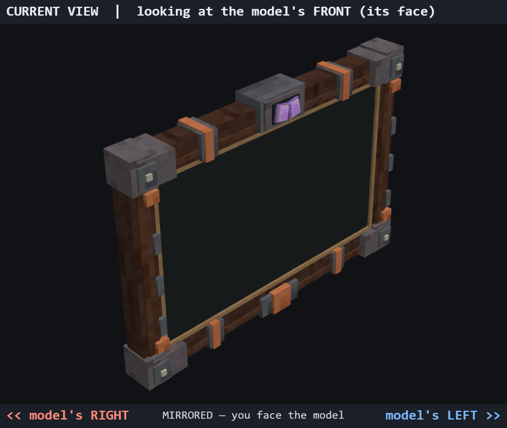

# Quest Plus — tablette et animations

Sources éditables, textures et exports graphiques indépendants du backend. Dernière révision : 4 novembre 2026.

L’intégration Minecraft actuelle, les essais visuels et leurs limites sont détaillés dans [le rapport PR #2](../docs/reviews/native-tablet.md). Les aperçus ci-dessous documentent la fabrication initiale ; la première personne de référence utilise désormais une caméra `[0,17.6,0.5]` et des bras arrivant par le bas.

La dernière demande visuelle est appliquée : **aucune grappe d'améthyste**, livre ouvert détaillé sur le médaillon supérieur, écran tourné vers le joueur pendant la consultation. Un observateur devant le personnage voit le dos de la tablette. Le petit cabochon du dos est conservé ; ce n'est pas une grappe.



## Ouvrir les sources

Dans Blockbench 5.2.2 : Fichier → Ouvrir un modèle, puis choisir un fichier sous `blockbench/`. Aucun plugin n'est nécessaire : les cinq sources utilisent **Generic / Modèle libre**, avec les textures intégrées au fichier.

| Source | Contenu |
|---|---|
| `questplus_tablet.bbmodel` | Tablette seule, 79 cubes, groupes et ancrages, trois pistes de mouvement |
| `questplus_first_person.bbmodel` | Bras classiques et tablette de référence, trois animations |
| `questplus_first_person_slim.bbmodel` | Variante à bras de trois pixels |
| `questplus_third_person.bbmodel` | Mannequin vanilla classique et tablette de référence, trois animations |
| `questplus_third_person_slim.bbmodel` | Variante extérieure slim |

Dans les projets mannequin, `tablet_root` est un sous-arbre indépendant. Il peut être supprimé ou remplacé sans toucher aux bras. Le modèle autonome ne contient aucun bras. Les textures du mannequin sont séparées dans `textures/preview_mannequin.png` ; Minecraft devra utiliser le skin réel du joueur. Le mannequin n'est pas un remplacement du personnage vanilla.

## Construction et coordonnées

Le cadre combine noyer sombre, pierre taillée, fer, brides cuivrées et un médaillon en forme de livre aux pages violettes. L'écran reste sombre, sans texte, boutons, motifs ni interface dessinée. Le dos reçoit des sangles, des attaches et une petite rose des vents en relief.

Coordonnées ci-dessous : **source Blockbench**, avant transformation de tenue. Une unité vaut 1/16 de bloc. Origine et pivot `tablet_root` : `[0,0,0]`. +Y = haut, face décorée vers −Z, droite du joueur vers +X.

| Élément | Coordonnées |
|---|---|
| Cadre principal | environ 24 × 16 × 2,2 unités |
| Encombrement avec médaillon et reliefs | X : −12,1 à 12,1 ; Y : −8,3 à 8,65 ; Z : −2,12 à 1,35 |
| Surface visible de l'écran | X : −10 à 10 ; Y : −6 à 6 ; Z = −0,82 |
| Plan proposé pour le rendu dynamique | Z = −0,835, normale `[0,0,-1]` |
| Rapport d'écran | **5:3**, 20 × 12 unités ; choisi pour se rapprocher du visuel fourni |
| Coin supérieur gauche écran | `[-10,6,-0.835]` ; U vers +X, V vers −Y |
| `left_hand_anchor` | `[-11.2,-2,1.1]` |
| `right_hand_anchor` | `[11.2,-2,1.1]` |

Les ancrages sont des guides de placement sur les zones de prise ; ils ne constituent pas des doigts animés ou une contrainte IK. Les groupes dédiés `tablet_body`, `screen`, `frame`, `metal_corners`, `carved_stone`, `crystals`, `back_details` restent éditables. `crystals` contient les détails violets du livre, sans grappes extérieures.

Tenue en repère joueur : **échelle 0,65**, translation `[0,18.8,-10.5]`, rotation de repos **Y = 180°**. Ainsi la face écran regarde +Z, vers le joueur. L'échelle et la translation sont déjà incorporées à la géométrie de référence des mannequins ; la rotation est dans les animations. Ne pas les appliquer une seconde fois à cette géométrie. Le modèle autonome nécessite la transformation de tenue lors de son futur rendu. `models/attachment.json` reprend ces repères.

Bras classiques : largeur 4, profondeur 4, hauteur totale 12. Bras slim : largeur 3. Pivots des épaules `[5,22,0]` et `[-5,22,0]` ; tête `[0,24,0]`. Les bras vanilla restent rigides, sans coude ni poignet indépendant : les rotations sont celles des épaules. Les mains n'ont pas de skin définitif.

## Textures et UV

`textures/questplus_tablet.png` : atlas pixel art **256 × 256**, bois veiné, métal bordé de reflets, variations de pierre et cuivre, pages et cabochon violet. Aucun canal émissif : la couleur violette n'implique aucun néon. Utiliser un filtrage nearest et éviter de lisser les pixels.

Chaque face de la tablette dispose de sa propre île UV. La densité cible est de deux pixels par unité ; les très petites faces utilisent au minimum un pixel. Une bordure extrudée réduit les fuites entre îles. Les manches et mains de prévisualisation réutilisent volontairement certains UV sur **leur propre texture**. `models/atlas-layout.json` contient la liste des rectangles alloués, y compris les zones réservées au mannequin puis retirées de l'atlas de la tablette.

## Animations

Le livre du médaillon est droit : pages et couverture sans rotation. L'ouverture
et la fermeture durent désormais 1 seconde au lieu de 1,2 seconde ; les poses
et l'idle restent identiques. Les aperçus animés historiques ci-dessous
précèdent cette accélération.

| Première personne | Troisième personne | Durée | Boucle |
|---|---|---|---|
| `questplus.open` | `questplus.third_person_open` | 1,00 s | Non |
| `questplus.idle` | `questplus.third_person_idle` | 4 s | Oui |
| `questplus.close` | `questplus.third_person_close` | 1,00 s | Non |

L'ouverture est un **geste asymétrique de sortie de poche**, échantillonné à 50 images/s sur des courbes Hermite continues :

1. 0 à 0,20 s : la droite va vers la hanche/poche droite, la gauche reste au repos.
2. À partir de 0,20 s : la tablette apparaît au point de saisie, tenue d'une main et encore inclinée près du côté droit.
3. 0,20 à 0,67 s : la droite la remonte et la tourne vers le joueur ; la gauche commence son approche après 0,40 s.
4. 0,67 à 1,0 s : la gauche se place sous le bord opposé, le mouvement se stabilise et le joueur baisse le regard.

La vue subjective ajoute des déplacements verticaux propres aux bras pour les faire entrer depuis le bas du champ, avec la tablette provenant de la droite. Ces déplacements FP ne sont pas appliqués au personnage extérieur. La fermeture reprend exactement le trajet en sens inverse : la gauche relâche, la droite redescend vers la poche, puis les bras reviennent au repos.

La tablette est masquée par une piste d'échelle nulle pendant le geste initial vers la poche, puis devient visible à 0,20 s. Elle est à nouveau masquée en fin de rangement. C'est une transition de visibilité, pas un effet de croissance. Le personnage vanilla n'ayant pas de poche articulée, aucun tissu ne s'ouvre et la tablette entière n'est pas simulée à l'intérieur du pantalon. Le point de saisie et les corrections de contact sont calculés à partir de la main droite ; une enveloppe lissée empêche les intersections des mains avec le cadre.

L'idle déplace l'ensemble bras/tablette de seulement **0,045 unité** en hauteur, sans rotation de l'écran. Les valeurs au raccord ouverture → idle → fermeture coïncident. Pour un raccord en cours d'idle, finir le cycle ou fondre brièvement vers la première pose de fermeture. Conserver les pistes `scale` lors de l'export pour respecter la visibilité.

`questplus.tablet_open`, `questplus.tablet_idle`, `questplus.tablet_close` sont les mouvements autonomes de `tablet_root` synchronisés avec la **troisième personne**. Les déplacements propres au cadrage FP restent dans l'export FP ; ils ne doivent pas s'ajouter à ces pistes autonomes.

La pose extérieure incline la tête de 17° vers la tablette. Les membres inférieurs du mannequin servent uniquement de repère ; aucune animation de marche n'est exportée.

## Formats d'export et intégration future

Les projets `.bbmodel` ne sont pas chargés directement par Minecraft. Le format Java Block/Item classique ne porte pas ces animations. Nous conservons donc la géométrie Bedrock 1.12.0, les animations Bedrock 1.8.0 et un **glTF autonome** pour la réutilisation dans d'autres outils. Les exports finaux sont produits par les codecs du Blockbench local.

`models/questplus_tablet.geo.json` est la tablette seule, utilisable comme base pour un renderer prenant en charge la géométrie Bedrock, notamment une intégration GeckoLib adaptée à la version retenue. Aucune dépendance GeckoLib n'a été ajoutée au mod. Le glTF n'est pas un modèle Minecraft directement installable.

Pour les bras vanilla, les conventions et emplacements ont été vérifiés dans la [documentation PAL](https://docs.zigythebird.com/pal/features/bones/) et la [documentation FP PAL](https://github.com/RazorPlay01/First-Person-PAL-Expansion/wiki). PAL normalise `rightArm`/`leftArm`. Les deux projets annoncent Fabric 26.3 sur leurs pages de distribution : [PAL](https://modrinth.com/mod/player-animation-library), [FP PAL](https://modrinth.com/mod/fp_pal). Choisir et épingler les versions réelles lors de l'intégration.

Disposition proposée **dans le futur mod client**, sans installer ces fichiers maintenant :

```text
assets/questplus/
  player_animations/questplus_third_person.animation.json
  fp_animations/questplus_first_person.animation.json
  fp_models/questplus_first_person.geo.json
  textures/fp/questplus_first_person.png
```

Correspondances : les deux JSON d'animation viennent de `animations/player/`, le modèle FP de `models/questplus_first_person.geo.json`, et la texture FP est une copie de `textures/questplus_tablet.png`. Le modèle FP omet les cubes des bras pour laisser Minecraft rendre le vrai skin ; il conserve leurs os de repère et la géométrie indépendante de la tablette. Le nom du fichier permet à FP PAL de résoudre son modèle associé.

Le rig FP est nommé `fp_player_arms`. L'export inclut une configuration de cadrage `camera`, échelle 1, translation `[0,-22,-2]` en pixels de modèle, et les pistes de la tablette. **Cette translation est une proposition d'auteur, à calibrer en jeu selon FOV et résolution ; elle n'est pas une mesure validée dans Minecraft.** Les mannequins Blockbench restent exprimés dans un repère physique de joueur pour faciliter les comparaisons classic/slim. Leur caméra n'émule pas le pipeline de rendu de FP PAL.

Pour la troisième personne, charger les pistes des bras et de la tête via PAL et rendre séparément la tablette avec la transformation documentée et son animation autonome synchronisée. La synchronisation réseau, le déclenchement, le skin, la visibilité de l'objet et le rendu dynamique de l'écran restent à écrire dans le futur client. Aucun code de frontend ou de backend n'est fourni ici.

Attention aux conversions : Blockbench 5 retourne ses rotations X/Y et ses positions X avec les signes convertis lors de l'export Bedrock. Le codec natif assure aussi les inversions UV nécessaires. Ne pas recopier directement les angles du `.bbmodel` dans un moteur Java sans conversion ; le JSON exporté et le repère source ne sont pas interchangeables.

## Prévisualisations et vérifications exécutées

- Les **cinq projets ont été chargés, enregistrés puis rouverts dans Blockbench 5.2.2** par le pont local du plugin MCP, port 8787.
- `check_model` : **zéro problème signalé sur les cinq projets** après correction des faces coplanaires.
- Captures natives `previews/blockbench_*.png` : avant, arrière, profil, isométrique, consultation subjective/extérieure, classique et slim.
- Aperçus animés natifs à 25 images/s : [première personne](previews/blockbench_first_person_motion.gif), [troisième personne](previews/blockbench_third_person_motion.gif). Ils montrent l'ouverture, une courte tenue et la fermeture dans Blockbench.
- `analyze_animation` exécuté sur les douze animations des mannequins ; rapports bruts dans `previews/blockbench-verification.json`.
- Contrôles indépendants dans `validation.json` : structure, UV, textures intégrées, écran libre, raccords et boucles, départ de la droite avant la gauche, fermeture inverse, collisions de boîtes orientées aux clés, aux milieux d'intervalles et sur 41 instants uniformes par ouverture/fermeture, mains/tablette et tête/torse/tablette. Ce sont des contrôles échantillonnés, pas une preuve continue de toutes les collisions possibles.
- `./gradlew build` exécuté avec Java 25 : succès, tests Java et quatre GameTests serveur passés. Ces tests du backend ne chargent pas les assets graphiques.

Les images `front.png`, `back.png`, `profile.png`, `isometric.png`, `first_person*.png`, `third_person*.png`, les planches `*_stages.png` et les deux GIF sont des **rendus logiciels** de la géométrie et des pistes, pas des captures Minecraft. Les captures préfixées `blockbench_` viennent de l'éditeur réel. Les étiquettes front/back du pont décrivent l'orientation globale du mannequin, pas la face de la tablette qu'il tient.

Caméra subjective native : position `[0,25.6,1]`, cible `[0,18.8,-10.5]`, projection perspective, FOV 65°. Vue extérieure native : `[30,28,-40]`, cible `[0,19,-4]`, FOV 65°. Les rendus logiciels utilisent une projection orthographique, fenêtre verticale de 25 unités en consultation subjective.

Les heuristiques génériques de contrôle de rig signalent l'absence de coudes et de jambes animées ; c'est attendu pour les bras vanilla et ce mannequin de prévisualisation. L'analyse d'idle signale aussi une amplitude faible et des clés linéaires : l'amplitude est volontaire pour la lecture et les courbes sont pré-échantillonnées. Les rapports sont conservés sans masquer ces alertes. L'écran est volontairement une grande face sans détail ; le contrôle de complexité la signale à ce titre.

La référence fournie a été comparée visuellement : cadre, cuivre, pierre et livre reprennent sa composition, sans copier son interface. Aucun score de comparaison automatique n'est revendiqué : l'image jointe au chat n'était pas disponible comme fichier local dans le pont.

**Intégration exécutée depuis :** chargement Minecraft par PAL/FP PAL, cinq configurations FOV/résolution/GUI Scale, skins classiques/fins, interface sur la face et interactions. Le renderer extérieur a été contrôlé avec deux avatars et les paquets du serveur intégré. Deux connexions de joueurs réels et les shaders tiers restent à valider ; voir le rapport PR #2.

## Reproduire

Python 3, Pillow et NumPy sont nécessaires uniquement pour les scripts de fabrication et de contrôle.

```powershell
python questplus-assets/tools/build_assets.py
python questplus-assets/tools/verify_blockbench.py
python questplus-assets/tools/validate_assets.py
python questplus-assets/tools/capture_motion.py
```

Le deuxième script nécessite Blockbench ouvert avec le pont local actif. Il utilise le codec natif, réenregistre les sources et actualise les captures. Le premier script **reconstruit les assets et écrase les retouches manuelles** : ne le relancer que pour repartir de la recette. Pour retoucher les modèles, travailler directement dans Blockbench et conserver les `.bbmodel`.

Les ressources nécessaires sont copiées sous `client/src/main/resources/assets/questplus/` et incluses dans le JAR. Pour exporter les sources de référence sans les reconstruire :

```powershell
python questplus-assets/tools/export_first_person.py
python questplus-assets/tools/export_third_person.py
python questplus-assets/tools/export_third_person.py --check
```
